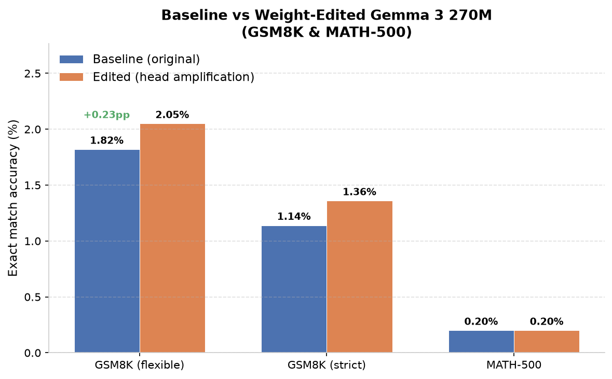
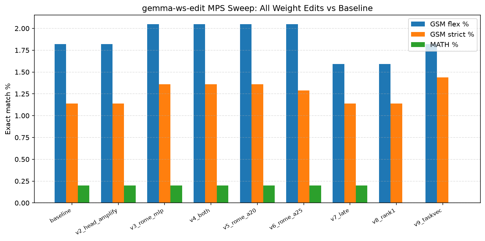
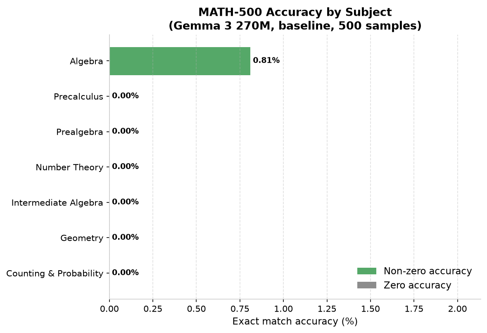
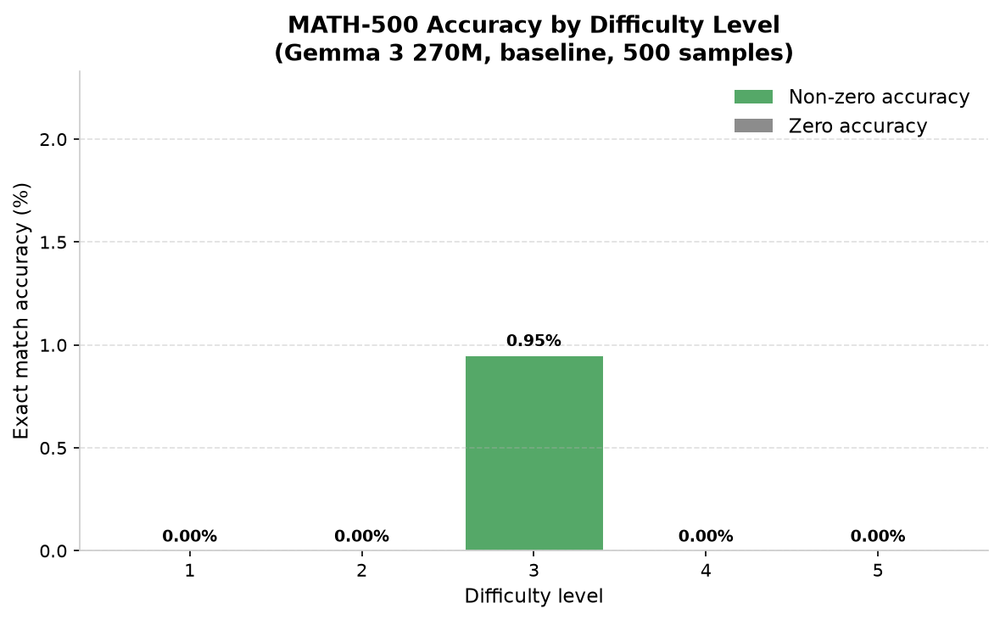
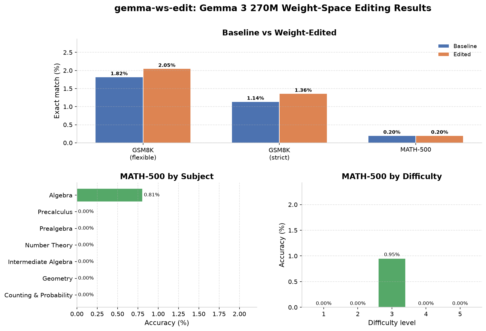

# gemma-ws-edit

Direct weight-space editing for Gemma 3 270M math reasoning -- no finetuning, no retraining.

## What this project does

**gemma-ws-edit** explores whether you can improve a language model's math performance by editing its weights directly, instead of fine-tuning or retraining. We work with Google's Gemma 3 270M model and measure results on GSM8K and MATH-500.

The core idea is simple: rather than gradient descent over thousands of examples, we apply targeted weight manipulations -- scaling attention heads, ROME-style MLP fact edits, task vector addition -- then re-benchmark the same edited checkpoint. Every change is reversible, minimal, and compared against a documented baseline.

## Why this matters

Fine-tuning a 270M model on math data requires compute, time, and labeled data. Weight-space programming asks a different question: can we squeeze better reasoning out of a model we already have, by adjusting its internal parameters directly? If even small, interpretable edits move the needle, it suggests a path to lightweight model improvement without the cost of full retraining.

## What we tried and what happened

MPS-only comparisons (float32, batch 4, identical lm-eval). T4 numbers were reference only.

| Approach | GSM8K (flexible) | GSM8K (strict) | MATH-500 | Correct /1319 |
|----------|-----------------|----------------|----------|---------------|
| Baseline MPS | 1.82% | 1.14% | 0.20% | 24 |
| v2 Head all (T4 first pass) | 1.82% | 1.14% | 0.20% | 24 |
| **v3 MLP mid 6-12 α=1.5 = best published** | **2.05%** | **1.36%** | **0.20%** | **27** |
| v4 Head+MLP | 2.05% | 1.36% | 0.20% | 27 |
| v5 MLP α2.0 | 2.05% | 1.36% | 0.20% | 27 |
| v6 MLP α2.5 | 2.05% | 1.29% | 0.20% | 27 |
| v7 MLP late 9-17 | 1.59% | 1.14% | 0.20% | 21 |
| v8 ROME rank-1 | 1.59% | 1.14% | 0% | 21 |
| v9 Task-vector 0.2 | 1.82% | 1.44% | 0% | 24 |

### Baseline MPS
- **GSM8K CoT**: exact_match flexible 0.0182 ± 0.0037 (24/1319), strict 0.0114 ± 0.0029 (15/1319)
- **MATH-500**: 0.002 ± 0.002 (1/500, 0-shot)
- Full JSONs in `results/full_baseline_local/`

### Best published
- `saidutta69/gemma-3-270m-math-rome-best` = v3 MLP layers 6-12 α=1.5 (down_proj 640x2048 x7 = 9.17M params, 3.4% changed)
- Gain +3 correct (27 vs 24), below significance bar of 34 (baseline +2*stderr). Honestly reported, MATH-500 flat.

Full sweep figures in `assets/charts/` including `mps_sweep_all.png` for all 9 runs.

## Results Visualization

### Baseline vs Weight-Edited





### MATH-500 by Subject



### MATH-500 by Difficulty Level



### Summary Dashboard



All charts are generated from the result data in `charts/data/` using `charts/generate_charts.py`. Both PNG and SVG versions are available in `assets/charts/`.

## Techniques we're exploring

1. **Attention head amplification** -- Scale output projection weights of math-relevant attention heads. Low risk, fully reversible.
2. **ROME-style MLP fact edits** -- Use causal tracing to find MLP layers mediating arithmetic facts, then apply rank-1 updates to those weight matrices.
3. **Task vector addition** -- If a compatible math-finetuned Gemma 3 270M variant exists, compute θ_math − θ_base and add a scaled copy to the base weights.
4. **Function vector injection** -- Extract function vectors from activations mediating math reasoning and inject them approximately into weights.

All edits are weight manipulations only -- no fine-tuning, no gradient descent over benchmark data. We keep edits minimal and always compare against the same baseline using the same evaluation setup.

## Repo structure

```
gemma-ws-edit/
├── README.md           # This file -- project overview, results, quickstart
├── AGENTS.md           # Root project context for AI agents and contributors
├── GATES.md            # Checklist of documentation and plan gates
├── LICENSE             # MIT license
├── .gitignore          # Standard Python + model cache ignores
├── scripts/            # Benchmark execution scripts
│   ├── run_bench.py    # Runs lm-eval benchmarks (GSM8K, MATH-500)
│   ├── quick_eval.py   # Quick local sanity check on a few problems
│   └── AGENTS.md       # Scripts directory context
├── charts/            # Chart data (CSV) + generation script
│   ├── data/          # CSV data files for charts
│   ├── generate_charts.py  # Matplotlib chart generator
│   └── AGENTS.md      # Charts directory context
├── assets/            # Generated visual assets
│   └── charts/        # PNG + SVG charts (embedded in README)
├── results/           # Evaluation outputs (JSON, JSONL samples)
│   ├── google__gemma-3-270m/   # Baseline results
│   └── AGENTS.md       # Results directory context
├── logs/               # Runtime execution logs
│   └── AGENTS.md       # Logs directory context
├── models/             # Model artifacts and checkpoints (not committed)
│   └── AGENTS.md       # Models directory context
├── docs/               # Research notes and detailed documentation
│   ├── WEIGHTSPACE_PROGRAMMING_PLAN.md   # Full editing plan and techniques
│   ├── BENCHMARK_LOG.md                  # Complete benchmark run log
│   ├── HANDOFF.md                          # Handoff notes for GPU VM work
│   └── AGENTS.md       # Docs directory context
└── dox/                # DOX tree documentation
    └── AGENTS.md       # DOX directory context
```

## Quick start

### Prerequisites

- Python 3.10+
- `torch`, `transformers`, `lm-eval`, `accelerate`

### Run a benchmark

```bash
# Clone the repo
git clone https://github.com/<your-username>/gemma-ws-edit.git
cd gemma-ws-edit

# Create a virtual environment
python3 -m venv .venv
source .venv/bin/activate

# Install dependencies
pip install lm-eval transformers torch accelerate

# Run GSM8K + MATH-500 on the base model
python scripts/run_bench.py
```

The script downloads `google/gemma-3-270m` from HuggingFace, runs the benchmarks, and writes results to `results/` and logs to `logs/`.

### Quick local test

```bash
python scripts/quick_eval.py
```

Runs the model on a few GSM8K-style word problems and prints generations. Good for sanity-checking before a full benchmark run.

## Compute recommendations

- **Laptop (Mac MPS):** Slow. Fine for quick tests, not full benchmarks.
- **CPU server:** Workable for GSM8K, very slow per-sample generation.
- **GPU VM (2x Tesla T4):** Best for both weight editing and benchmarking. A 270M model loads in ~1GB float32; tracing and benchmarks run much faster.

One heavy job at a time on shared CPU servers.

## Contributing

This is a research project. Contributions are welcome:

- Try a new weight-editing technique (ROME, MEMIT, task vectors, circuit pruning)
- Improve the benchmark scripts or add new tasks (Minerva, MATH, etc.)
- Reproduce or extend the baseline results on different hardware
- Document failed experiments (negative results are valuable too)

Open an issue to discuss, or submit a pull request.

## Citation

If you use this work, please cite:

```
@misc{gemma-ws-edit,
  title = {gemma-ws-edit: Direct Weight-Space Editing for Gemma 3 270M Math Reasoning},
  author = {gemma-ws-edit contributors},
  year = {2026},
  url = {https://github.com/<your-username>/gemma-ws-edit}
}
```

## License

MIT License. See LICENSE for details.